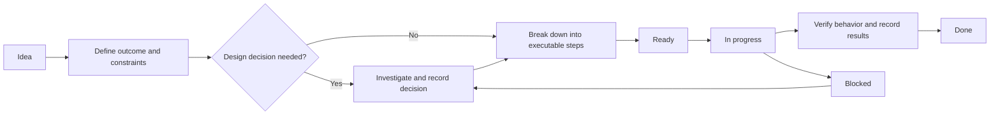

# Project status and backlog

This file is the leading source for current status, next actions, backlog, requirements, and investigation notes. Statuses below are an initial snapshot from 2026-10-17; work-area implementation status has not been verified unless the status text says otherwise.

**Last reviewed:** 2026-10-17
**Current focus:** Not selected

## Status and next action

| Work area | Status | Next action |
| --- | --- | --- |
| Trade execution safety | Needs triage | Check Trade/Xch implementation and tests against the safety notes; identify the highest-priority unaddressed failure mode. |
| Kraken order lifecycle | Needs triage | Compare documented Spot/Futures bracket behavior with current adapters and tests; record what remains open. |
| Strategy experiments | Needs triage | Select a gain-limit alternative and define its simulation metric and acceptance criteria. |
| IBKR Spot | Blocked: paper-account market data was unavailable after enabling the advised live-account market-data setting; the test was on a Saturday, so repeat during trading hours. | Inspect the adapter and paper-trading coverage, then resolve the outstanding API-level questions. |
| IBKR Options | On hold until IBKR Spot is fixed. | Confirm option-chain data and selection decisions against the IBKR API before defining the adapter contract. |
| Signals and targets | Needs triage | Choose a signal/target hypothesis and turn it into a bounded experiment with measurable success criteria. |
| Runtime diagnostics | Needs triage | Reproduce or profile one concern and capture a baseline before choosing a fix. |
| Trading validation | Needs triage | Compare the current simulation/test suite with documented use cases and identify the first missing scenario. |

## Work area outcomes and tracking

### Trade execution safety

- **Outcome:** Reliable position and order lifecycle, including rejected orders, liquidation handling, and protective exits.
- **Tracking:** Verify protective/OCO handling for every open amount; inventory reject and liquidation paths; check the single-long/single-short intent and order replacement per symbol; add or update simulated tests for confirmed gaps.

### Kraken order lifecycle

- **Outcome:** Correct close-before-opposite-open behavior without duplicate submissions or unnecessary tick latency.
- **Tracking:** Verify websocket close-completion and successor-open behavior; reconcile KrakenSpot conditional-close support with its order path; confirm KrakenFutures post-fill protective-order timing; decide how pending successor requests and duplicate-submission races are handled if asynchronous resubmission is needed.

### Strategy experiments

- **Outcome:** Compare strategy variants using repeatable simulations while controlling fees and downside risk.
- **Tracking:** Specify entry, renewal, and exit rules; define target gain, evaluation window, and risk/fee measures; implement the variant behind an isolated strategy path; compare it with the current strategy on the same data.

### IBKR Spot

- **Outcome:** Predictable order management that does not interfere with manual trading.
- **Tracking:** Verify paper-trading coverage for create, upsert, and cancel; investigate sharing market data across usernames without duplicate subscriptions; determine whether robot orders can be identified separately from manual orders; record API constraints and decide whether implementation changes are needed.

### IBKR Options

- **Outcome:** A clear interface for mapping underlying-stock signals to call/put candidates.
- **Tracking:** Verify strike, expiry, volume, bid/ask, model, last-price, and symbol fields; decide how long/short signals map to calls/puts and how expirations are selected; define liquidity and best-buy-price criteria; write the proposed interface and unresolved decisions before creating the package.

### Signals and targets

- **Outcome:** Trainable targets and features that support robust, measurable trading signals.
- **Tracking:** Select a hypothesis and specify its target event and time horizon; identify required features and data partitions; define a baseline and evaluation measures; run the experiment and record its result before promoting it to a strategy change.

### Runtime diagnostics

- **Outcome:** Explainable memory use, warnings, logs, and liquidity/range decisions.
- **Tracking:** Measure memory use by data history and classifier loading; categorize warnings and identify actual race conditions; clarify whether opened/closed logs mean order submission or fill; check liquidity thresholds and BoundsEstimator range-id behavior against intended rules.

### Trading validation

- **Outcome:** Evidence that trading behavior handles trend changes, adverse movement, and execution edge cases.
- **Tracking:** Check coverage for a close and opposite open in the same minute; check extreme volatility, stop-loss, and liquidation scenarios; check gradual loss reduction without excessive fee-generating turnover; define and measure robustness to multi-day trend changes.

## Strategy ideas

- Implement alternative 1 to `gain_limit_reversal!`:
	- Buy long only below 4h regression.
	- Do not renew the limit with a new open signal.
	- Intent: harvest more high-frequency 1% gains.
- Implement alternative 2 to `gain_limit_reversal!`:
	- Keep the renewal concept, but fall back to an ASAP close if price is above `pavg + target gain` and there has been no supporting open signal for X minutes.
	- Intent: follow an upswing, then materialize gains quickly when it ends.
- Further ideas:
	- Set stop loss at `feegain` if gain is greater than 2x `feegain`.
	- Sell at `feegain` if gain does not exceed 2x `feegain` within `feegainmaxminutes`.
	- Above `targetgain`, set stop loss to `targetgain` and follow the trend with `incrementtargetgain`.
	- Above `targetgain`, sell as soon as there is no open (or hold) support.

## IBKR Spot adapter

- Is it possible to use market data from one username and execute on the robot username without a second market-data subscription, for example by running TWS and IB Gateway in parallel with different usernames?
- Implement paper-trading tests for order create, upsert, and cancel.
- Can robot orders be identified in IBKR to avoid interfering with manual orders, for example by preventing the robot from cancelling manual orders?

## IBKR Options adapter

- Create a package similar to `IbkrSpot`. Trade decisions will use the underlying stock's price development. Map long trades to calls and short trades to puts.
- Provide an interface returning possible call or put options. Each option should expose strike, expiration, 24-hour volume, ask and ask volume, bid and bid volume, model price, last traded price, and a symbol/string identifier.
- Check the request against the IBKR API and identify any design decisions needed before implementation.
- Define liquidity and best-buy-price algorithms to select suitable options and strike prices.

## Known issues

- Always set an OCO bracket order for an open amount in trade.
- Make `trade!` handle rejects (FMEA); set `l_status` to reject when appropriate.
- Exit the program on liquidation.
- Investigate the reported jumps in the SOLUSDT open; see the graph reference in Additional information.
- Complete true sub-minute, websocket-event-triggered successor-order submission; design and race-handling notes are in Additional information.
- Evaluate native KrakenSpot conditional-close parameters versus the current path; KrakenFutures does not appear to offer an equivalent linked bracket API. Details are in Additional information.
- Reduce the generic KrakenSpot/KrakenFutures liquidation fill-price approximation; see the known gap in Additional information.
- Check high TradeSim memory use, including memory breakdown, classifier loading per symbol, and retained OHLCV history.
- Investigate multiple orders per symbol and frequent order changes.
- Clarify whether opened/closed logs mean order placed or order filled.
- Categorize warnings; determine which are actual race conditions.
- Review liquidity-check thresholds.
- Verify that BoundsEstimator follows the range-id numbering scheme: 10000 steps for liquidity range, with subranges representing sets within that range.

## Requirements and validation

### Risk constraints

- Positions shall apply to the constraints documented in [tradereal risk constraints](docs/tradereal-risk-constraints-overview-2026-06-03.md).

### Intent

- Maximum one long and one short order per symbol.

### To be validated

- The implemented strategy shall be robust against multi-day trend changes; a short trend shall not significantly reduce equity.

### Test use cases

- Close and opposite open in the same minute.
- Extreme volatility forcing stop loss and liquidation.
- Gradual losses shall result in gradual reduction of the corresponding position, with enough hysteresis to avoid high-frequency buy/sell trades and significant fees.
- TradeSim and TSM reporting shall be able to consider or ignore pair, set, and range-id grouping, while processing all pairs per minute.
- Adapt stop loss every time a new open portion is added or the close limit is adapted.
- Define `trade!` failure modes for `l_rejects` and the appropriate reactions.

## Additional information and investigation notes

The notes below preserve investigation context and rationale. Treat them as background for the backlog items above, not as proof that the items are complete or as a substitute for verifying the current implementation.

### Websocket close completion and successor orders

True sub-minute, websocket-event-triggered resubmission of the open order at the instant a close-fill event arrives has not been implemented. It would avoid waiting for the next minute in live KrakenSpot/KrakenFutures trading, but requires a background asynchronous callback that submits live orders outside the normal per-minute tick loop. That introduces concurrent order submission touching real capital and is difficult to test without live exchange access.

The current fix guarantees correctness: the successor does not open before the close resolves, based on websocket-first data. The remaining tradeoff is at most one extra tick of latency. Before implementing event-driven resubmission, decide where pending successor-order specifications live and how the callback and normal tick loop avoid duplicate submissions.

### Kraken bracket/OCO API investigation

The API review found different capabilities for Spot and Futures:

- **KrakenSpot:** `AddOrder` supports `close[ordertype]`, `close[price]`, and `close[price2]` on the entry request. Kraken documents conditional close orders as being triggered by execution of the primary order in the same quantity and opposite direction, after which they are independent orders. This could let the exchange sequence the stop close with the entry fill. The current `KrakenSpot.createorder` / `_addorderparams` path does not set these parameters, so using them requires new wiring.
- **KrakenFutures:** `SendOrder` supports standalone conditional order types (`stp`, `take_profit`, `trailing_stop`) with `triggerPrice`, `triggerSignal`, and `reduceOnly`, but the reviewed API does not link a protective order to a specific entry order as Spot does. The current post-fill `_ensurestoploss!` approach therefore remains relevant. Whether a dormant Futures trigger can safely be submitted earlier needs empirical confirmation.

The investigation proposed implementing native `close[...]` brackets for KrakenSpot while retaining post-fill `_ensurestoploss!` for KrakenFutures. Confirm that design against current adapter code and API documentation before implementation.

### Liquidation fill-price approximation

The generic KrakenSpot/KrakenFutures fallback uses the current bar's close as an approximation of the real liquidation fill price. Getting the exact fill would require querying exchange trade-history endpoints; that was not implemented because the response shapes had not been verified sufficiently for live trading.

### Market graph reference

The reported SOLUSDT open is smooth, but jumps were observed in a detailed BTCUSDT graph. The referenced screenshot is `/Users/torsten/Library/Application Support/Code/User/workspaceStorage/vscode-chat-images/image-1787490346920.png`.

### Idea-to-delivery workflow

Use this flow to turn an open-ended idea into a small, verifiable change. Keep the idea and its executable steps together in this file.

### Updating status and handing off work

Before pausing a work area, record its status, latest verified result, any blocker or decision needed, and one concrete next step. To resume, read the relevant work-area summary and linked source notes; do not infer progress from an unchecked item. When a step completes, mark it, capture its evidence (test, analysis, or decision), update **Last reviewed**, and move the work area to its new status. Keep broad ideas here until they have a defined outcome and executable steps.
