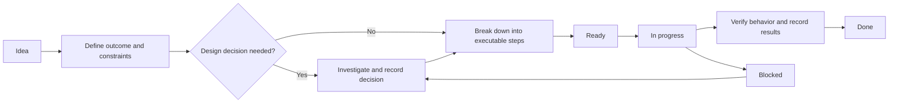

# Project planning board

Use this board to switch between independent work areas without losing the latest status or next action. The initial snapshot is based on the existing notes; implementation status has not yet been verified. Treat every item as **Needs triage** until its current state is checked.

**Last reviewed:** 2026-10-17 (initial snapshot; no work-item status verified)  
**Current focus:** Not selected

## Status board

Move each work area between columns as its status changes. Keep one next action visible per area, even when another area is the current focus.

| Needs triage | Ready | In progress | Blocked | Done |
| --- | --- | --- | --- | --- |
| [Trade execution safety](#trade-execution-safety) [Kraken order lifecycle](#kraken-order-lifecycle) [Strategy experiments](#strategy-experiments) [IBKR Spot](#ibkr-spot) [IBKR Options](#ibkr-options) [Signals and targets](#signals-and-targets) [Runtime diagnostics](#runtime-diagnostics) [Trading validation](#trading-validation) | — | — | — | — |

## Idea-to-delivery flow

Use this flow to turn an open-ended idea into a small, verifiable change. Keep the idea and its executable steps together on the work-area card.

## Work areas

For every area, update **Status**, **Last update**, and **Next step** when work changes. Move the area's link to the matching status-board column. Record a blocker explicitly rather than leaving an item apparently active.

### Trade execution safety

- **Status:** Needs triage
- **Last update:** Not reviewed
- **Next step:** Check the current Trade/Xch implementation and tests against the outstanding safety notes; identify the highest-priority unaddressed failure mode.
- **Outcome:** Reliable position and order lifecycle, including rejected orders, liquidation handling, and protective exits.
- **Breakdown:**
  - [ ] Verify that every open amount receives the intended protective/OCO handling.
  - [ ] Inventory reject and liquidation paths and define expected responses.
  - [ ] Check the single-long/single-short intent and order replacement behavior per symbol.
  - [ ] Add or update simulated tests for any confirmed gap.
- **Source:** `../ToDo.md` — Known issues, Intent, and Test use cases.

### Kraken order lifecycle

- **Status:** Needs triage
- **Last update:** Not reviewed
- **Next step:** Compare the documented Spot/Futures bracket behavior with the current adapters and tests, then record which pieces remain open.
- **Outcome:** Correct close-before-opposite-open behavior without duplicate submissions or unnecessary tick latency.
- **Breakdown:**
  - [ ] Verify the current websocket close-completion and successor-open behavior.
  - [ ] Reconcile KrakenSpot native conditional-close support with the Spot order path.
  - [ ] Confirm KrakenFutures post-fill protective-order behavior and its timing assumptions.
  - [ ] If asynchronous resubmission is still needed, decide how pending requests and duplicate-submission races are handled before implementation.
- **Source:** `../ToDo.md` — Known issues; `kraken-private-ws-support-note-2026-05-31.md`.

### Strategy experiments

- **Status:** Needs triage
- **Last update:** Not reviewed
- **Next step:** Select one gain-limit alternative and define its simulation metric and acceptance criteria before implementation.
- **Outcome:** Compare strategy variants using repeatable simulations while controlling fees and downside risk.
- **Breakdown:**
  - [ ] Specify the entry, renewal, and exit rules for the selected variant.
  - [ ] Define the target gain, evaluation window, and risk/fee measures.
  - [ ] Implement the variant behind an isolated strategy path.
  - [ ] Compare results against the current strategy on the same data.
- **Source:** `../ToDo.md` — next to do and further ideas; `../notes.md` — ToDo prio and strategy ideas.

### IBKR Spot

- **Status:** Needs triage
- **Last update:** Not reviewed
- **Next step:** Inspect the existing adapter and paper-trading coverage; list which outstanding integration questions still need an API-level answer.
- **Outcome:** Predictable order management that does not interfere with manual trading.
- **Breakdown:**
  - [ ] Verify paper-trading coverage for create, upsert, and cancel.
  - [ ] Investigate sharing market data across usernames without duplicate subscriptions.
  - [ ] Determine whether robot orders can be identified separately from manual orders.
  - [ ] Record API constraints and decide whether implementation changes are needed.
- **Source:** `../ToDo.md` — IBKR Spot adapter.

### IBKR Options

- **Status:** Needs triage
- **Last update:** Not reviewed
- **Next step:** Confirm the required option-chain data and selection decisions against the IBKR API before defining the adapter contract.
- **Outcome:** A clear interface for mapping underlying-stock signals to call/put candidates.
- **Breakdown:**
  - [ ] Verify availability and meaning of strike, expiry, volume, bid/ask, model, last price, and symbol fields.
  - [ ] Decide how long/short signals map to calls/puts and how expirations are selected.
  - [ ] Define liquidity and best-buy-price selection criteria.
  - [ ] Write the proposed interface and unresolved decisions before creating the package.
- **Source:** `../ToDo.md` — IBKR Options adapter.

### Signals and targets

- **Status:** Needs triage
- **Last update:** Not reviewed
- **Next step:** Choose one signal/target hypothesis from the research notes and turn it into a bounded experiment with measurable success criteria.
- **Outcome:** Trainable targets and features that support robust, measurable trading signals.
- **Breakdown:**
  - [ ] Select a hypothesis and specify the target event and time horizon.
  - [ ] Identify the required features and data partitions.
  - [ ] Define a baseline and evaluation measures.
  - [ ] Run the experiment and record the result before promoting it to a strategy change.
- **Source:** `../notes.md` — ToDo prio, Partitioning, Adaptation approach, and target ideas.

### Runtime diagnostics

- **Status:** Needs triage
- **Last update:** Not reviewed
- **Next step:** Reproduce or profile one reported concern and capture a baseline before choosing a fix.
- **Outcome:** Explainable memory use, warnings, logs, and liquidity/range decisions.
- **Breakdown:**
  - [ ] Measure memory use and break it down by data history and classifier loading.
  - [ ] Categorize warnings and identify which represent actual race conditions.
  - [ ] Clarify whether opened/closed logs mean order submission or fill.
  - [ ] Check liquidity thresholds and BoundsEstimator range-id behavior against their intended rules.
- **Source:** `../ToDo.md` — Known issues.

### Trading validation

- **Status:** Needs triage
- **Last update:** Not reviewed
- **Next step:** Compare the current simulation/test suite with the documented use cases and identify the first missing scenario.
- **Outcome:** Evidence that trading behavior handles trend changes, adverse movement, and execution edge cases.
- **Breakdown:**
  - [ ] Check coverage for a close and opposite open in the same minute.
  - [ ] Check extreme volatility, stop-loss, and liquidation scenarios.
  - [ ] Check gradual loss reduction without excessive fee-generating turnover.
  - [ ] Define and measure robustness to multi-day trend changes.
- **Source:** `../ToDo.md` — To be validated and Test use cases.

## Switching focus and agent handoff

Before pausing an area, record its current status, the latest verified result, any blocker or decision needed, and one concrete next step. To resume, read that area's card and linked source notes first; do not infer progress from an unchecked breakdown. When a step completes, mark it, capture the evidence (test, analysis, or decision), update **Last update**, and move the area on the board. Keep broad ideas in the source notes until they have a defined outcome and executable steps.
